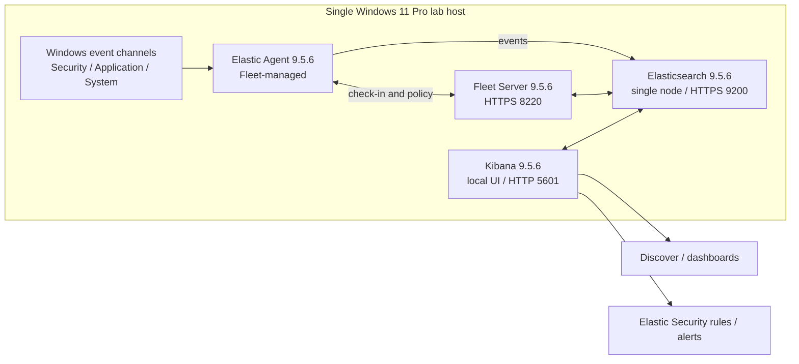

# Elastic Windows Home-Lab SOC — Project Status

**Status date:** 2026-11-24  
**Stage:** Functional telemetry foundation; custom rules enabled; alert investigation still in progress.

## Executive summary

This project is a single-PC learning lab for Windows event collection and SOC workflows. Elasticsearch, Kibana, Fleet Server, and a Fleet-managed Elastic Agent run on the same Windows 11 Pro host. Windows Security, Application, and System events have been visible in Discover. Two custom rules are enabled, and Kibana has reported successful scheduled executions for both. A successful execution proves the query ran; it does not by itself prove a matching event or alert was produced.

The lab currently provides log-based monitoring, not endpoint detection and response. It has no confirmed Elastic Defend/EDR, Sysmon, second endpoint, vulnerability scanner, or automated response. No Windows security settings were changed during the baseline checks; the user asked to keep the PC's settings as-is.

## Architecture

All components are on one Windows PC. Addresses and host identifiers are omitted from this public-safe project record.

**Data path:** Windows emits events → Elastic Agent reads configured channels → Agent sends events directly to Elasticsearch → Kibana Discover searches them. Elastic Security scheduled rules query the source events and store alert documents when the rule matches. Fleet Server provides Agent check-in and policy control; it is not the event data path.

**Configured stack:** Elasticsearch 9.5.6, Kibana 9.5.6, Fleet Server 9.5.6, Elastic Agent 9.5.6 Servers flavor. The existing Fleet Server Policy was reused and has Fleet Server, System, and Windows integrations configured. Do not create duplicate policies or integrations. The Agent was shown as Healthy in Fleet.

**Verified event datasets:** `system.security`, `system.application`, and `system.system`. The Windows-specific Defender, PowerShell, and Sysmon channels have not been established as reliable data sources in this lab. Earlier Discover screenshots contained event codes 4624, 4672, and 4799; a later query found one System event 7045.

## Detection rules and evidence

| Rule | Query | Configuration | Verified result | What remains |
|---|---|---|---|---|
| Windows Security audit log cleared | `event.dataset:"system.security" and event.code:"1102"` | Custom query; `logs-*`; High; risk 73; every 5m; 1m additional lookback; no actions | Enabled. Execution results showed **Succeeded**, 0 alerts created. Discover found no 1102 event in the checked 24h period. | No alert match or alert investigation demonstrated. Do not clear the real Security log to test. |
| Windows service installed | `event.dataset:"system.system" and event.code:"7045"` | Custom query; `logs-*`; Medium; risk 47; every 5m; 1m additional lookback; no actions | Enabled. Rule list showed last response **Succeeded**. Discover previously showed one 7045 event at 2026-11-24 16:15:29.858. | A Security detection alert from the historical/manual run has not been confirmed. Check **Security → Detections → Alerts**, not Observability → Alerts, then inspect the service details before disposition. |

An attempted Notion-install check searched `event.dataset:"system.application" and event.code:"11707"` over the last 24 hours and returned no results. Event 11707 is a Windows Installer/MSI success event; its absence does not mean Notion failed to install, and the 7045 service rule does not detect every software installation. No Notion installation detection is claimed.

## Read-only host baseline

| Check | Observed result | Project interpretation |
|---|---|---|
| Windows version | Windows 11 Pro, build 22631 | Baseline recorded |
| Windows Firewall | On for Domain, Private, and Public; inbound blocked, outbound allowed | Positive control |
| Microsoft Defender | Service/antivirus and real-time protection enabled; signature timestamp shown as 2026-11-24 | Positive control |
| Remote Desktop | Disabled (`fDenyTSConnections=1`) | Positive control |
| System drive | 110.23 GB, fully decrypted; BitLocker protection off; no key protectors | Data-at-rest protection gap documented; no change requested or made |
| TPM | `TpmPresent=False`, `TpmReady=False` | Hardware/firmware cause not determined; no firmware changes requested or made |
| Hotfixes, free disk, local administrators | Not successfully captured in the supplied baseline output | Unknown; do not infer findings |

These are configuration observations, not a CVE scan. Log collection does not establish that the PC is free of vulnerabilities. The user explicitly requested that Windows settings remain unchanged.

## Limitations and risks

- One PC hosts the SIEM stack, Fleet Server, and the monitored endpoint; it is a single point of failure.
- One Elasticsearch node provides no node redundancy. Earlier startup logs showed yellow health from unassigned replicas; current cluster health has not been rechecked in this project snapshot.
- No EDR/Elastic Defend, Sysmon, or verified process command-line telemetry is present. Do not claim process-tree detection, containment, or host isolation.
- No vulnerability scanner or software-CVE inventory has been run. Do not claim vulnerability management or remediation completion.
- 4799 and 4672 can reflect routine OS/application or privileged logon activity. Investigate event fields and context before classifying.
- Notion install telemetry was not observed as 11707 in the checked range. Installers do not all use Windows Installer.
- Earlier logs reported low disk headroom; confirm disk space before adding scanners, integrations, or VMs. The host has 8 GB RAM.
- Elastic/Kibana and Fleet ports should remain private to the home lab. Public artifacts must exclude raw logs, API keys, enrollment/service tokens, usernames, LAN addresses, and other host identifiers.

## Next milestones

1. Verify the 7045 rule's manual/historical run in Elastic Security and inspect the generated alert, if present. Review service name, image path, account, and timestamp; only then decide whether expected activity is a false positive.
2. Record the 1102 rule's successful execution as execution-only validation; there is no matching event to test the alert path.
3. Add another detection only after confirming its source event and required fields in Discover. The already observed 4799 event is a candidate for a benign historical alert investigation.
4. Build and save a small Windows event dashboard. Discover searches are verified, but a finished dashboard has not yet been evidenced.
5. Capture remaining baseline items only if useful and read-only. Do not change endpoint settings.
6. Export sanitized rules and documentation for a chosen GitHub repository, then prepare a LinkedIn progress series. No public GitHub upload or LinkedIn post is recorded as completed.

## Honest portfolio description

> Built a self-managed Elastic SIEM home lab on Windows 11 Pro. Enrolled a Fleet-managed Elastic Agent, verified Windows Security, Application, and System event ingestion, and created two custom detections with successful scheduled executions. Documented host baseline controls, data-source limitations, and the distinction between rule execution and confirmed alert generation. The lab is single-host and log-based; EDR, vulnerability scanning, and alert triage validation remain in progress.

Supporting detail: [README](README.md) · [Architecture and sequence](docs/architecture.md) · [Detection plan](docs/detection-plan.md) · [Host assessment](docs/host-assessment.md) · [Portfolio copy](portfolio-copy.md)
