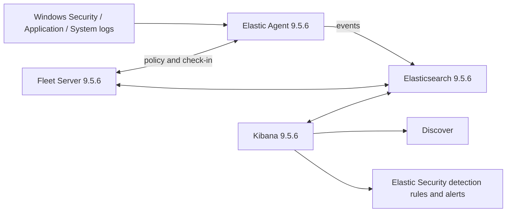

# Windows Home Lab SOC with Elastic

## Project status

This is a single-host Windows home-lab SOC built to practice log collection, detection engineering, alert triage, and evidence-based reporting. The stack is running, Fleet reports the enrolled Agent as Healthy, and Discover has shown Windows Security, Application, and System events. Two custom detection rules are enabled and have successful scheduled executions. Alert generation and triage for those rules are not yet confirmed.

See [PROJECT-STATUS.md](PROJECT-STATUS.md) for the full current architecture, verified work, rule status, limitations, and next milestones. Local host details are intentionally generalized for public sharing.

## Architecture at a glance

All components share one Windows 11 Pro lab PC. The Agent sends events directly to Elasticsearch; Fleet Server handles management check-ins and policy delivery. Kibana is the analyst interface. See [architecture and sequence](docs/architecture.md) for component roles, the sequence diagram, and design limits.

## What this lab demonstrates

- Fleet-managed Windows event collection and data validation in Discover.
- KQL custom detections, scheduled execution, and the difference between a successful query run and an alert match.
- A documented analyst workflow for checking event context and classifying results carefully.
- Read-only host baseline observations without changing the user's PC settings.

## Current rule status

| Detection | State | Evidence so far |
|---|---|---|
| Windows Security audit log cleared (1102) | Enabled; scheduled execution succeeded | 0 alerts on the recorded run; no 1102 source event found in the checked time range |
| Windows service installed (7045) | Enabled; scheduled execution succeeded | One 7045 source event was found; a matching Security alert and its disposition are not yet confirmed |

These rules create alerts only when their query matches an event. They do not block activity or perform endpoint response. See [detections](detections/README.md) and the [alert investigation runbook](docs/alert-investigation-runbook.md).

## Project plan

1. Collect Windows Security, Application, and System events; verify any additional Windows channels before relying on them.
2. Build a concise event dashboard and verify its data sources.
3. Enable and maintain a small set of applicable detections.
4. Validate alert generation using existing historical telemetry where possible, then investigate and document dispositions.
5. Keep endpoint assessment read-only; do not change Windows settings.
6. Prepare sanitized architecture, rule logic, screenshots, and findings for publication without credentials or private event data.

The detailed project state and verified evidence are in [PROJECT-STATUS.md](PROJECT-STATUS.md); the ordered roadmap is in [docs/project-roadmap.md](docs/project-roadmap.md).

## Scope and limitations

This is a single-node lab, not a production SOC. A healthy Agent and event ingestion prove that telemetry is flowing; they do not prove that the host has no vulnerabilities. Windows Defender returning no events in a short time range can be normal. Vulnerability findings and detection results must be separately assessed and evidenced.

The computer has 8 GB RAM. Earlier Elasticsearch logs reported low disk headroom; check current free space before adding heavier agents, scanners, or virtual machines. Keep Elasticsearch and Fleet ports private to the lab network; do not publish credentials, service tokens, raw logs, or identifying host data. The lab has no confirmed Elastic Defend/EDR or Sysmon, and no vulnerability scanner has been run.

## Repository guide

- [Project status](PROJECT-STATUS.md) — current implementation and evidence.
- [Architecture and sequence](docs/architecture.md) — topology, data flow, and known design gaps.
- [Fleet and detection policies](docs/fleet-and-detection-policies.md) — what the collection policy and alert rules do.
- [Detection plan](docs/detection-plan.md) — rule candidates, prerequisites, and maturity.
- [Alert investigation runbook](docs/alert-investigation-runbook.md) — repeatable analyst process.
- [Host assessment](docs/host-assessment.md) — read-only baseline observations.
- [Project roadmap](docs/project-roadmap.md) — completion milestones and exit criteria.
- [Hiring analyst walkthrough](docs/hiring-analyst-walkthrough.md) — how to present the work honestly.
- [GitHub publishing guide](docs/github-publishing-guide.md) — safe repository setup.

## Current interview summary

I built a self-managed Elastic SIEM home lab on Windows 11 Pro, enrolled a Fleet-managed Elastic Agent, and verified Security, Application, and System event ingestion in Kibana Discover. I created two custom detections—Windows Security audit log cleared (1102) and Windows service installed (7045)—and confirmed successful scheduled executions. I am validating alert generation from historical events and documenting the limits of a single-host, log-only lab.

Do not claim that either rule generated a confirmed alert, that the Notion installation was detected, that EDR is deployed, or that vulnerability scanning/remediation is complete until evidence supports it.
