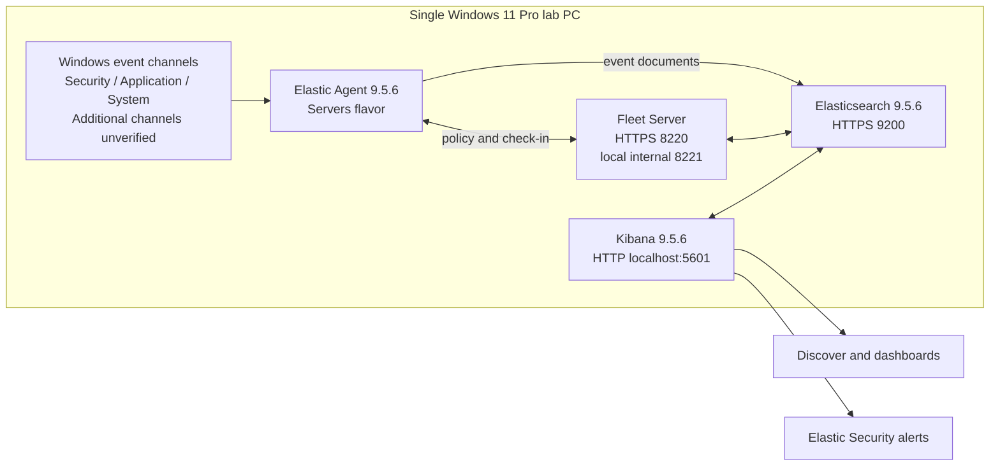
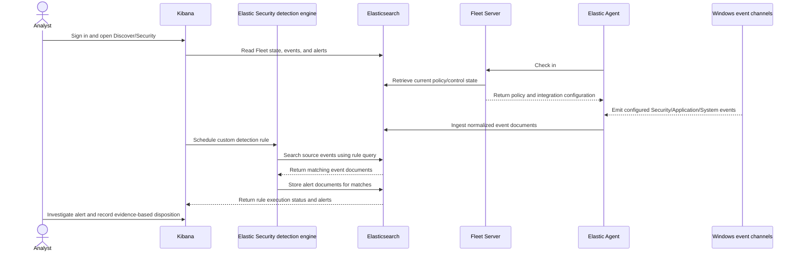

# Architecture and event flow

## Current architecture

Fleet Server is the control plane for Agent check-ins and policy delivery. The Agent's configured System and Windows integrations read Windows sources and send event documents to Elasticsearch. Kibana queries Elasticsearch and displays events and detection results. The current single host uses HTTPS Fleet Server port 8220 and local internal port 8221. Public documentation intentionally omits the PC's LAN address and account/host name.

### Current component inventory

| Component | Current state |
|---|---|
| Windows | Windows 11 Pro, build 22631 |
| Elasticsearch | 9.5.6, single node, HTTPS on the private lab host |
| Kibana | 9.5.6, local browser access on port 5601 |
| Fleet Server | 9.5.6, HTTPS on port 8220; local internal communication on 8221 |
| Elastic Agent | 9.5.6 Servers flavor, enrolled; Fleet showed Healthy |
| Fleet policy | Existing Fleet Server Policy reused; Fleet Server, System, and Windows integrations configured |
| Verified event datasets | `system.security`, `system.application`, `system.system` |
| EDR / Elastic Defend | Not deployed or verified |

## Event sequence

## Proposed next-stage architecture

Keep the current one-PC layout for the first demo. Any future expansion—such as Elastic Defend or a separate Windows target VM—requires a capacity review and a deliberate lab design. Do not add a heavy scanner or extra VM until the host has adequate free disk and memory. A future segmented lab could isolate the target and test tools on a host-only virtual network while keeping Elasticsearch/Kibana management access restricted. No endpoint setting changes are part of the current work.

## Known architecture gaps

- Elasticsearch, Kibana, Fleet Server, and the monitored endpoint share one physical host; this creates a single point of failure.
- The cluster is single-node and previously reported yellow health/no replica assignment; it has no node-level redundancy.
- Self-signed TLS was used during local setup. Keep it private to the lab; review certificates before exposing endpoints beyond the local network.
- Fleet Server's advertised host uses a private lab address; a DHCP address change could affect check-ins unless a stable address or hostname is maintained.
- The project has one endpoint so far. Fleet can manage more hosts, but capacity must be checked first.
- Application, PowerShell, Defender, and Sysmon data streams are not all verified; do not imply process-level or EDR visibility.
